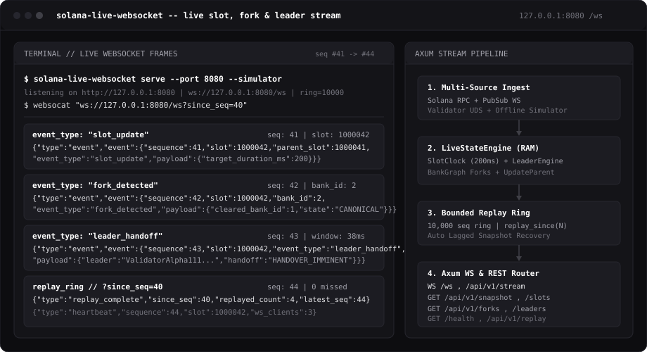

# solana-live-websocket


fast rust axum websocket server + cli that streams live solana slots, candidate forks, and leader handoff windows.

wrote this at 3am with cold adrak chai because polling `getSlot` in a `while true` loop was making my eyes bleed.



## what this does

- streams live solana slots, forks, candidate banks, and leader changes over one clean `/ws` socket.
- sends a full cluster snapshot the instant your client connects so your ui is never blank.
- keeps a 10,000-event ring buffer in ram. wifi died? not a bug bhai, reconnect with `?since_seq=42` and zero slots missed.
- if a slow client falls way behind, server sends a `lagged` recovery frame with a fresh snapshot instead of crashing.
- tracks competing candidate banks and `UpdateParent` switches so dead forks do not fool your app.
- shows how many milliseconds are left before the current slot leader hands over the mic.
- includes a built-in `--simulator` mode for instant offline testing on localhost (free speed feature, zero rpc bill).
- when i wrote the `tokio::select!` broadcast loop in `ws.rs`, only me and bhagwan knew how it compiled. now only bhagwan knows.

## copy and run in 60 sec

1. start the server in offline simulator mode (no rpc key or internet needed):

```bash
cargo run -p solana-live-websocket -- serve --port 8080 --simulator
```

2. grab the full cluster snapshot in another terminal:

```bash
curl -s http://127.0.0.1:8080/api/v1/snapshot | jq .
```

3. watch live websocket frames (`websocat`, browser `new WebSocket(...)`, or python/ts client):

```bash
# live stream with snapshot on connect
websocat "ws://127.0.0.1:8080/ws"

# reconnect and replay everything after sequence 42
websocat "ws://127.0.0.1:8080/ws?since_seq=42"
```

4. point it at real solana devnet or testnet whenever you want:

```bash
cargo run -p solana-live-websocket -- serve --port 8080 --cluster devnet
```

5. run all unit and real websocket integration tests:

```bash
cargo test --workspace
```

## websocket frames you get

- `snapshot`: sent right on connect with current slot, leader lookahead, and active banks.
- `event`: live updates (`slot_update`, `fork_detected`, `bank_created`, `update_parent`, `leader_handoff`, `finality_changed`).
- `replay_complete`: confirms how many missed events got replayed after `?since_seq=N`.
- `lagged`: safety net with a fresh snapshot if your client slept past the ring buffer.
- `heartbeat` / `pong`: keeps idle proxies from dropping your socket while you go make more chai.

```json
{
  "type": "event",
  "event": {
    "sequence": 42,
    "slot": 1000042,
    "bank_id": 2,
    "event_type": "fork_detected",
    "payload": {
      "bank_id": 2,
      "slot": 1000042,
      "state": "CANONICAL"
    }
  }
}
```

## http endpoints

| method | path | what it returns |
| :--- | :--- | :--- |
| `GET` | `/ws` or `/api/v1/stream` | live websocket feed (`?since_seq=N` and `?snapshot=false` supported) |
| `GET` | `/health` | quick health and uptime check |
| `GET` | `/api/v1/snapshot` | full slot, fork, leader, and finality state in one json |
| `GET` | `/api/v1/slots` | current slot timer + recent observed slots |
| `GET` | `/api/v1/forks` | candidate banks, canonical fork, and `UpdateParent` history |
| `GET` | `/api/v1/leaders` | current leader, next leader, and 10-slot lookahead |
| `GET` | `/api/v1/capabilities` | what fields the active upstream source supports |
| `GET` | `/api/v1/replay?since_seq=40` | fetch buffered events over plain http |
| `POST` | `/api/v1/simulate` | run a repeatable fork or leader handoff test scenario |

## cli commands

- `solana-live-websocket serve --port 8080 --simulator`: start http + websocket server.
- `solana-live-websocket status --cluster testnet`: print quick cluster and leader status.
- `solana-live-websocket live --slots 10 --simulator`: print live slot frames in terminal.
- `solana-live-websocket inspect --simulator`: check supported stream fields.
- `solana-live-websocket capture --events 50 --out ./captures/demo`: save raw events to `events.jsonl`.
- `solana-live-websocket replay ./captures/demo/events.jsonl`: replay saved file and print state hash.

## env vars

- `LIVE_WS_HOST`: bind host (default `127.0.0.1`).
- `LIVE_WS_PORT`: bind port (default `8080`).
- `LIVE_WS_CLUSTER`: `testnet`, `devnet`, or `mainnet-beta` (default `testnet`).
- `LIVE_WS_SOURCE`: `rpc`, `uds`, or `simulator` (default `rpc`).
- `SOLANA_RPC_URL`: custom solana http rpc url.
- `SOLANA_WS_URL`: custom solana pubsub websocket url.
- `VALIDATOR_UDS_PATH`: local validator unix socket path (default `/tmp/solana_validator_stream.sock`).
- `LIVE_WS_RING_CAPACITY`: max events kept for `?since_seq=` replay (default `10000`).

## where to edit code

- `crates/solana-live-websocket/src/ws.rs`: axum websocket upgrade, `?since_seq=` replay, and heartbeat loop.
- `crates/solana-live-websocket/src/state.rs`: `LiveStateEngine` ram state + bounded replay ring buffer.
- `crates/solana-live-websocket/src/envelope.rs`: wire json shapes (`StreamEnvelope` and `LiveStreamEvent`).
- `crates/solana-live-websocket/src/snapshot.rs`: `LiveClusterSnapshot` structs returned on `/api/v1/snapshot`.
- `crates/solana-live-websocket/src/source.rs`: switches between solana rpc/ws, local validator uds, and simulator.
- `crates/solana-live-websocket/src/api.rs`: rest handlers (`/health`, `/slots`, `/forks`, `/leaders`).
- `crates/solana-live-websocket/src/main.rs`: cli subcommands (`serve`, `status`, `live`, `capture`, `replay`).
- `crates/live-ws-core/src/clock.rs`: `SlotClock` 200ms-400ms slot phase timer.
- `crates/live-ws-core/src/graph.rs`: `BankGraph` fork tracker and canonical bank picker.
- `crates/live-ws-core/src/adapters.rs`: rpc client, reconnecting websocket client, uds reader, and simulator fixture.

## license

MIT License. Copyright (c) 2026 LevCodeLab. works on pure divine code and 3am adrak chai.
